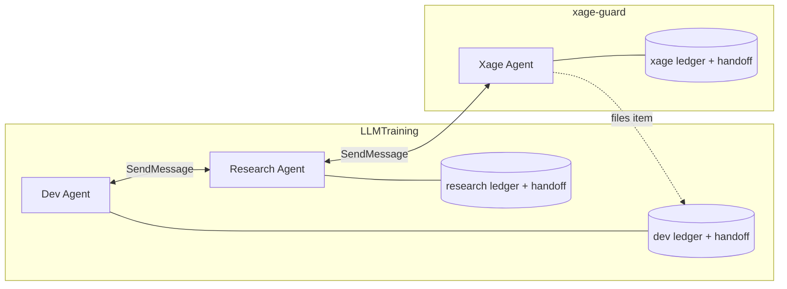
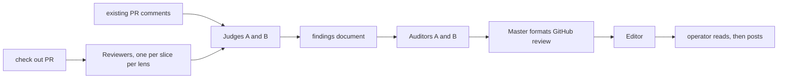

# Agents, ledger and handoff

Design workspace for the fresh slate. The previous Apex lives in `example/` as a reference only.

## Fixed opinions

- No planning step. The plan is a ledger item.
- An Agent owns exactly one ledger and one handoff (one per ticket in per-ticket mode), and works the ledger one item
  at a time, executing each item directly, through a subagent, or through Ultracode.
- A handoff's startup procedure points at the Agent's live notes (which replace Claude memory).
- Everything lives under `.claude/`. The role card, ledger, handoff and shared notes are tracked; each Agent's
  `.claude/apex/<agent>/` ignores itself and stays private to the main checkout.
- Binary-light: Go only where the answer must be deterministic.
- Ponytail is a required dependency.
- The protocol skills install as user skills, not a plugin, so they keep bare names (`/apex-init`); `make install`
  refuses to run without ponytail.
- One output style, `Apex`, ships with the skills and governs replies only: answer first, terse, ledger items cited by
  id, a completion claim backed by the command that proved it. It is opt-in through `/output-style`.
- Git is governed by a git-discipline skill with per-repo conventions; push and PR happen only on the operator's word.

## What an Agent is

An Agent is a user-defined skill. The user names it at session start; nothing selects it automatically. Any number of
Agents can be active in one repo at once, and they either work independently or collaborate.

An Agent defines two things:

1. What to pre-load: other skills (repo, user or plugin). The Agent is a standard-format skill whose body
   tells the model which skills to load at start; there is no custom frontmatter.
2. What it owns: one ledger and one handoff.

An Agent's skill, ledger and handoff live in its home repo. It may work in other repos, but its state never moves there.
Cross-repo work needs no special command: the Agent notes it in the ledger item it is working.

Built-in roles (build, review, research) are not Agents. They are single-use Ultracode or subagent roles that execute a
slice of some Agent's ledger item and report back; they own no state.

Example: LLMTraining runs a Dev Agent and a Research Agent at home, collaborating with a Xage Agent whose home is
`xage-guard`.



## Layout

```
<repo>/.claude/
  skills/<agent>/SKILL.md      role card, user-owned; body lists the skills to pre-load
  apex/<agent>/.gitignore      one line, *: the folder ignores itself
  apex/<agent>/LIVE.md         live notes, agent-owned; replaces memory
  apex/<agent>/Rules.md        what the operator allows
  apex/<agent>/skills/*.md     reminder skills, agent-owned
  LIVE.md                      shared notes: facts true for every Agent in this repo
  ledger/<agent>/NNN.md        one item per file, never deleted
  ledger/<agent>/handoff.md    one file, overwritten
  ledger/<agent>/per-ticket    optional marker: one ledger per ticket instead
  ledger/<agent>/<ticket>/     a ticket's own NNN.md items and handoff.md
  git.md                       this repo's commit, push and PR conventions
```

`SKILL.md` and the private folder are separate so the Agent can keep notes without rewriting its own role. Claude Code
live-reloads only `SKILL.md`, so the Agent reads the private folder with file reads at start rather than embedding it.
The folder lives only in the main checkout; a worktree reads it through `<repo>`.

| File | Holds | Written by |
|---|---|---|
| `LIVE.md` | facts about the current state that outlive one item | the Agent |
| `Rules.md` | what the operator has decided the Agent may do | the Agent, only from the operator's words |
| `skills/<topic>.md` | reminders on how to do the work: traps, good-to-knows, do's and don'ts, one topic per file | the Agent |

A rule starts with `Allowed:` and grants one specific action: what, on what, when. It carries no date and no history,
and holds no prohibition or trap; those go in a reminder skill. What no rule allows needs the operator's approval.

A reminder skill is not an Agent and never overrides the role card or the protocol. It is plain markdown read with a
file read, never discovered or invoked by Claude Code.

`.claude/LIVE.md` holds facts every Agent in the repo needs, kept once instead of copied into each Agent's notes. Every
Agent reads it at start, after its own `LIVE.md`, and any Agent may edit it.

`<repo>` is always the main checkout, even when the Agent works in a worktree.

## Mono or per-ticket ledger

Each Agent is in one of two modes, switched by the operator alone with an empty `per-ticket` file in its ledger
directory.

- **Mono** (no marker): one ledger and one handoff across every branch, worktree and ticket.
- **Per-ticket** (marker): every `apex` verb works on `ledger/<agent>/<ticket>/`, a full ledger with its own ids from
  001, its own in-progress item and its own `handoff.md`. `<ticket>` is the ticket id in the current checkout's branch,
  upper-cased (`feat/eng-42-login` gives `ENG-42`), or the branch name with `/` as `-` when it names none. A detached
  HEAD or a directory outside git falls back to the mono ledger. `apex list` prints `ledger: <dir>` first, so the Agent
  reads the handoff from the binary's answer instead of deriving the ticket itself.

A Dev Agent in per-ticket mode stays one Agent, working one ticket at a time, and switching branch switches its state.

## Ledger item

The binary owns the frontmatter; the model owns the body.

```
---
id: 007
title: one line
kind: task | followup
status: open | in-progress | closed
created: 2026-09-30
closed: 2026-10-01
reason: one line
---
## Goal       From: <who asked: user, 003, repo:agent/004>; what done means, checkable
## Approach   direct | subagent | ultracode, and why
## Log        one line per step; the crash cursor
## Outcome    written at close
```

An item too big for one pass closes with `reason: split: 008-010`, and the children are added.

`open -> in-progress -> closed`; `close` also works from open; `reopen` returns either to open. At most one item per
Agent is in progress.

The binary owns the frontmatter, so it also carries the only correction path: `apex retitle <id> <title>` replaces a
title in any status, and a wrong close reason is fixed with `reopen` then `close`, which also moves `closed:` to the
day of the correction.

## Session flow

1. The user invokes `/<agent>`. The Agent reads its private folder, its pre-loads and `handoff.md`, then runs the handoff's
   Startup steps.
2. Per item: `apex start`, execute (direct, subagent or Ultracode) logging each step, review plus
   `/ponytail:ponytail-review`, update the private folder, `apex close`, rewrite `handoff.md`.

Every stateful `apex` verb takes an explicit `--agent`. There is no default Agent.

## Handoff

The handoff is a markdown file the Agent writes and reads with ordinary commands; the binary has no handoff verb. Its
format and startup steps live in the Agent skill.

```
---
checkout: <absolute path of the checkout worked in>
branch: <git rev-parse --abbrev-ref HEAD>
head: <git rev-parse HEAD>
---
## Startup     invoke the Agent skill (reads its private folder and .claude/LIVE.md); apex list --agent <agent>
## State       current item and where it stopped, uncommitted work
## Next
## Open threads
```

The handoff is stale when the recorded checkout no longer exists, its branch differs, or the code outside `.claude/`
differs from `head` in either direction: `git diff --quiet <head> HEAD -- . ':(exclude).claude'` exits non-zero, which
also covers a branch moved backward and a `head` git no longer knows. Committing the handoff, ledger or `LIVE.md`
never makes it stale. `head` is always the full SHA. A stale handoff is still read; staleness tells the Agent to
reconcile State against what changed.

## Collaboration

- Peers talk through `ListAgents` and `SendMessage`.
- A peer can file an item into another Agent's ledger; only the owner starts or closes it.
- An Agent that receives a request replies right away when it has no item in progress, and otherwise files the request
  in its own ledger and replies with the item id.
- Peer traffic stays out of the operator's chat: the Agent acknowledges in one line and never repeats to the operator
  what it sent to a peer, unless it needs the operator's answer.
- `apex-init` writes these rules into the repo's `CLAUDE.md` section, so they hold before any skill loads.

## PR review

`/pr-review <pr> [general|ponytail|security|mega]` makes the session the Master Reviewer for one pull request. It owns
no ledger and no handoff: review stays a single-use role.



- The pull request is checked out in place when the checkout is clean, and into a worktree otherwise.
- The workflow is authored per pull request from the skeleton in the skill and passed inline; it is never saved.
- Two rules: at most 10 agents run at once, and every agent runs at `medium` effort or lower.
- Models are aliases (`sonnet` reviewers, `mythos` security reviewers, `opus` judges and editor, `fable` auditors), so
  each role follows the latest model of its tier.
- A and B never see each other's answer. What both keep goes on, what both drop is dropped, and a split goes one
  stage up: judges to auditors, auditors to the Master Reviewer.
- `NIT` and `LOW` findings go in the main comment; `ASK` and `ISSUE` go inline, and the main comment only points at
  them.
- Nothing is posted until the operator has read the draft and said how to post it.
- `mega` runs every lens in order and combines the findings before judging.
- The security lens runs only on `mythos`. Without it, `security` mode stops and `mega` skips the lens and says so.

## Git discipline

The `git-discipline` skill keeps the message rules of the current `atomic-git-discipline`: Conventional Commits, terse
subject, body only for a non-obvious why, no AI attribution. It changes three things.

1. **Per-repo conventions.** Each repo states its own commit, push and PR conventions in `.claude/git.md`: message
   format, branch naming, ticket prefixes, remotes, PR template. The skill reads that file first and falls back to its
   defaults for anything unstated. The `apex-init` skill writes it.
2. **Permission defaults.**

| Action | Default |
|---|---|
| Commit | on the operator's approval, or automatically when `.claude/git.md` says so |
| Push | on the operator's approval only |
| PR | only when the operator asks for one |

The Agent never reminds the operator to open a PR, and says nothing about pushing until the operator gives Sign off.

3. **Few commits.** A commit is a unit someone would review or revert on its own, never a save point, and
   `Commit: automatically` does not mean committing more often. The Agent considers a commit only when a ledger item
   closes, at Sign off, or before a branch switch, rebase or worktree removal. It then commits only when the work is
   whole, stands alone under its subject line, and is more than `.claude/` bookkeeping; bookkeeping waits for the next
   commit that carries code, or for Sign off. Otherwise the work stays in the tree and the handoff's State names it.
   The check is silent: the operator hears of a commit only when approval is required and the check passed. A direct
   order to commit skips the check.

## Session start and Sign off

The `apex-init` skill adds a short section to the repo's `CLAUDE.md` that frames every session.

- **Start:** invoke your Agent skill.
- **Sign off:** a notice the operator gives to end a session, handled by the `sign-off` skill. The skill runs from
  `/sign-off` or when the operator says "sign off". The Agent then:
  1. logs where the in-progress item stopped, or closes it;
  2. updates the private folder and `.claude/LIVE.md`;
  3. writes the handoff;
  4. cleans up what the session started: scratch files, servers, merged worktrees;
  5. commits the session's tracked `.claude/` changes per git-discipline, in the main checkout on whatever branch it
     has checked out, staging only the `.claude/` paths the session changed;
  6. reports unpushed commits. This is the only point where pushing comes up.

## Auto-memory

Auto-memory is off, and `LIVE.md` replaces it. When `settings.json` is committed, that setting applies to everyone who
works in the repo; the protocol accepts this.

## Init and migrate

A repo adopts the protocol in a single-use session that runs the `apex-init` skill. The skill inspects the repo and
routes to exactly one outcome:

| State found | Outcome |
|---|---|
| No agents, no ledgers | initialize from a blank slate |
| Agent skills, ledgers or handoffs in a foreign layout | migrate |
| Already follows the rules | report conformant, change nothing |

The binary has no init or migrate verb. The skill moves files and rewrites them, and files ledger items through
`apex add`.

Migration renumbers each Agent's items from 001 in old order and rewrites every reference to an old number inside the
repo: item bodies, handoffs, both `LIVE.md` levels, code and docs. References in other repos cannot be rewritten from
here; the skill lists them for the operator. Facts several Agents share go to `.claude/LIVE.md`, once.

An Agent whose `LIVE.md` still sits tracked in `.claude/skills/<agent>/` moves to its private folder by
[MIGRATION.md](../../MIGRATION.md).

LLMTraining is the first migration target. Its foreign layout: `DevLedger/` and `ResearchLedger/` at the repo root with
a hand-kept `INDEX.md`, handoffs in `docs/handoff/`, role cards in `.claude/skills/`, and project facts in memory.

## Open questions

1. `apex-init` detection: which signals prove a repo conformant. Evolving by design: implement first, dry-run on
   LLMTraining, then calibrate.
